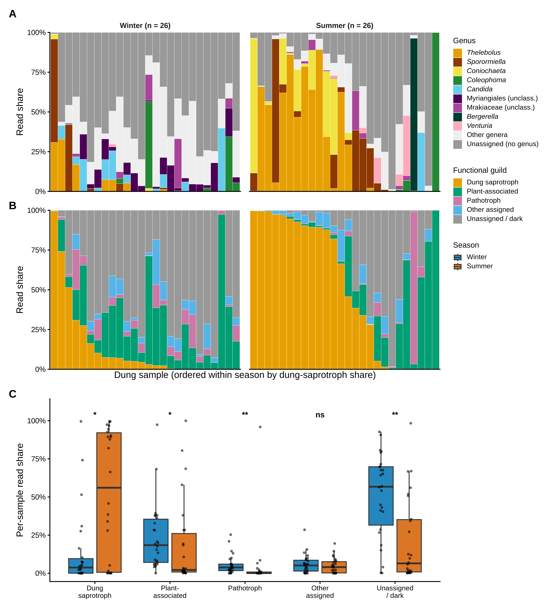
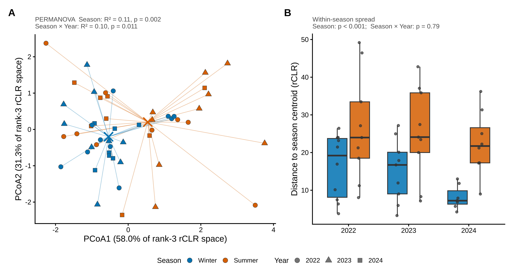
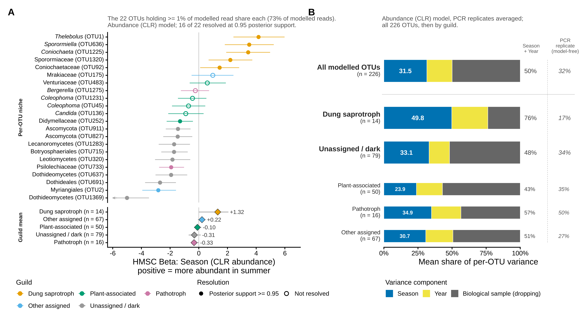
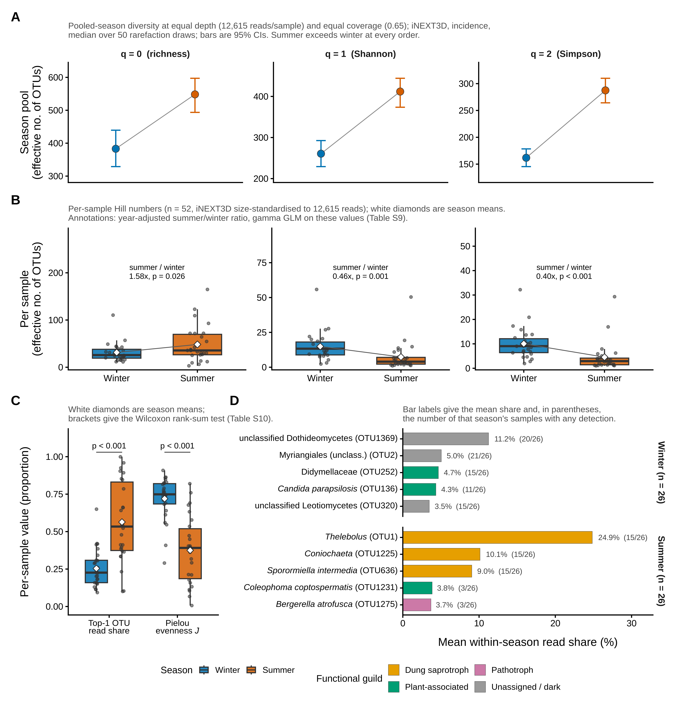
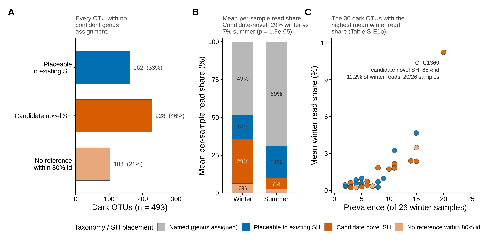

# Ptarmigan_fungi

Seasonal restructuring of the willow ptarmigan (*Lagopus lagopus*) dung mycobiome: an ITS2
metabarcoding study.

<!-- Daniel: edit this paragraph -->
Fungal ITS2 metabarcoding of willow ptarmigan droppings collected at Lifjellet (Lierne, Norway)
in winter (March) and summer (June) of 2022, 2023 and 2024 (52 droppings after quality
filtering). The analyses test three preregistered hypotheses (seasonal turnover in composition
(H1), seasonal and diet-linked alpha diversity (H2), and plant–fungus covariation on the
diet-matched subset (H3)) and one exploratory aim: unidentified "dark" taxa (E1).

## Supplementary appendix

**Read it online: <https://ssangulo.github.io/Ptarmigan_fungi/>**


The appendix holds the methods detail, every supplementary table and figure, and the code
behind each one (in collapsible blocks). Its source is
[`Supplementary/Supplementary_Appendix.qmd`](Supplementary/Supplementary_Appendix.qmd).

## Main-text figures

Click a thumbnail for the full-resolution PNG. Vector PDFs and 600-dpi JPGs sit next to it in
[`Supplementary/figures/main/`](Supplementary/figures/main/). The code that builds each figure
is in appendix Section 10.

| | Figure | Appendix |
|---|---|---|
| <a href="Supplementary/figures/main/Fig1_composition_function.png"></a> | **Figure 1.** Composition and function of the dung mycobiome | §10.1 |
| <a href="Supplementary/figures/main/Fig2_seasonal_turnover.png"></a> | **Figure 2.** Seasonal turnover and its year-to-year variation (H1) | §10.2 |
| <a href="Supplementary/figures/main/Fig3_hmsc_synthesis.png"></a> | **Figure 3.** A reproducible seasonal axis inside large among-individual variation (HMSC synthesis) | §10.3 |
| <a href="Supplementary/figures/main/Fig4_richness_evenness_crossover.png"></a> | **Figure 4.** Richness rises, evenness collapses (H2) | §10.4 |
| <a href="Supplementary/figures/main/Fig5_dark_taxa_SH.png"></a> | **Figure 5.** Dark, largely novel lineages dominate winter dung (E1) | §10.5 |

## Where to find what

| Folder | What it holds |
|---|---|
| [`Scripts/`](Scripts/) | The analysis pipeline, numbered in run order (table below). |
| [`Supplementary/`](Supplementary/) | Appendix source (`.qmd`), the figures and tables it shows, and its build and publish helpers. See its [README](Supplementary/README.md). |
| [`Supplementary/figures/main/`](Supplementary/figures/main/) | Main-text Figures 1–5. |
| [`Supplementary/figures/`](Supplementary/figures/), [`Supplementary/tables/`](Supplementary/tables/) | Supplementary figures (PNG) and result tables (CSV). |
| [`model_development/`](model_development/) | Two model-checking studies that led to the current H2/H3 (brms) and HMSC models. The appendix cites them. |
| [`repro/`](repro/) | Reproducibility harness: regenerates every appendix table and figure and checks the numbers quoted in the text. See its [README](repro/README.md). |

### Pipeline scripts

| Script | Step |
|---|---|
| [`1_demultiplexing.R`](Scripts/1_demultiplexing.R) | Demultiplexing (sabre) and primer trimming (cutadapt) |
| [`2_DADA2_lulu.R`](Scripts/2_DADA2_lulu.R) | DADA2 (non-pooled) inference, LULU curation, negative-control decontamination, phyloseq objects |
| [`3_taxonomic_assignment.R`](Scripts/3_taxonomic_assignment.R) | UNITE naive-Bayes taxonomy (minBoot 80) |
| [`4_data_prep.R`](Scripts/4_data_prep.R) | Non-fungal removal, depth filter, PCR-replicate collapsing: builds the analysis objects |
| [`5_community_composition.R`](Scripts/5_community_composition.R) | Ordinations and taxonomic composition (appendix §3.1) |
| [`6_diversity_analyses.R`](Scripts/6_diversity_analyses.R) | Hill-number diversity (H2), the diet-richness model (H2) and plant–fungus covariation (H3) (appendix §5, §7) |
| [`7_gllvm.R`](Scripts/7_gllvm.R) | GLLVM: per-OTU seasonal responses (H1) and the H3 cross-check (appendix §6, §7.3) |
| [`8_functional_guilds.R`](Scripts/8_functional_guilds.R) | FUNGuild functional guilds by season (appendix §8) |
| [`9_setup_sh_matching.sh`](Scripts/9_setup_sh_matching.sh), [`9_dark_taxa_SH_matching.R`](Scripts/9_dark_taxa_SH_matching.R) | UNITE Species Hypothesis matching of dark taxa (E1, appendix §3.4) |
| [`10_hmsc.R`](Scripts/10_hmsc.R) | HMSC joint species distribution model (appendix §9) |

## Reproducing the analyses

- **Environment:** R 4.3.3 in a conda environment (`r_env`). Each script's header lists the
  packages it uses. The appendix is rendered with Quarto 1.9.
- **Data:** the raw reads and the large intermediate objects (`eco_analysis.RData`, fitted
  models) are not stored in this repository. The scripts point at their location on the
  analysis server, and those paths need adjusting to run elsewhere. Scripts 5–10 can redirect
  their outputs through environment variables (`S5_OUT_ROOT` … `HMSC_OUT_ROOT`; see each
  script's header).
- **Render the appendix:**

  ```bash
  cd Supplementary
  quarto render Supplementary_Appendix.qmd --to html                       # submission version
  quarto render Supplementary_Appendix.qmd --to html --profile docs \
    --output Appendix_documentation.html                                   # full documentation version
  ```

- **Check reproducibility:** `./repro/run_repro.sh cached` regenerates every appendix table and
  figure and compares them with the committed copies. See [`repro/README.md`](repro/README.md).

## Data availability

Sequence data: ENA accession *(to be assigned)*.

## Licence

Code (`Scripts/`, `model_development/`, `repro/` and the R/shell helpers in `Supplementary/`)
is released under the [MIT licence](LICENSE). The appendix text, figures and tables are released
under [CC BY 4.0](LICENSE-content.md).

## Citation

*(Manuscript in preparation; citation to be added.)*
